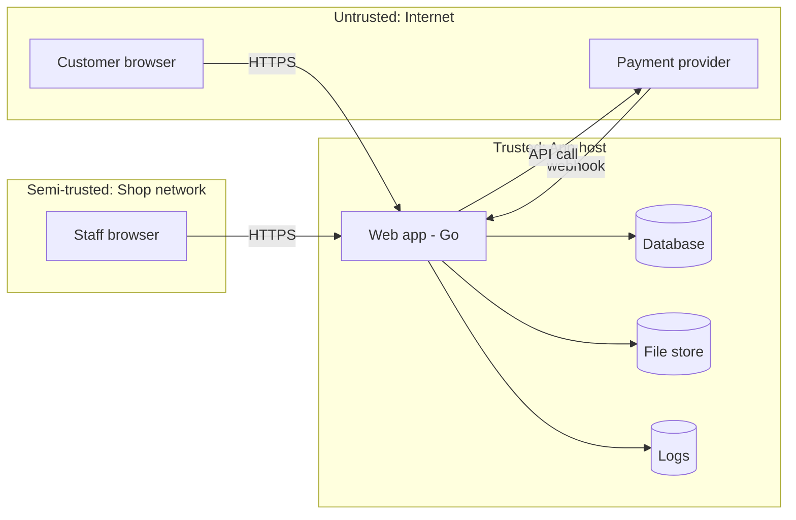

# Threat Model

## Method
1. Define scope and actors
2. Draw DFDs with trust boundaries
3. Apply STRIDE per element and per flow
4. Write abuse cases
5. Build attack trees for crown-jewel goals
6. Feed threats into `05-risk-register`

## Actors
| Actor | Trust level | Capabilities / motivation |
|---|---|---|
| Anonymous visitor | None | |
| Customer | Low | |
| Barista | Medium | |
| Manager | Medium-high | |
| Admin | High | |
| Malicious insider | Varies | |
| Payment provider (external) | Partial | |
| Automated bot | None | |

## DFD level 0 (starter, edit it)

## Trust boundaries
| ID | Boundary | Crossing flows |
|---|---|---|
| TB-1 | Internet <-> App | |
| TB-2 | App <-> Database | |
| TB-3 | App <-> Payment provider | |
| TB-4 | Staff network <-> App | |

## Threat register (STRIDE)
S = Spoofing, T = Tampering, R = Repudiation, I = Information disclosure, D = Denial of service, E = Elevation of privilege

| ID | Component / flow | STRIDE | Threat | Preconditions | Related feature | Risk ID |
|---|---|---|---|---|---|---|
| T-001 | Login | S | Credential stuffing against customer accounts | Leaked creds elsewhere | Auth | |
| T-002 | Order API | T | Client tampers with item price | Price accepted from client | Ordering | |
| T-003 | Order API | E | IDOR: customer reads another's order | Predictable IDs, weak authz | Ordering | |
| T-004 | Payment webhook | S | Forged "payment succeeded" request | No signature check | Payment | |
| T-005 | Gift card redeem | T | Race condition double-spends balance | No atomic update | Loyalty | |

## Abuse cases
| ID | As an attacker I want to... | So that... | Threat IDs |
|---|---|---|---|
| AC-001 | Redeem the same gift card twice in parallel | I get free coffee | T-005 |
| AC-002 | Replay a captured payment webhook | An order is marked paid again | T-004 |

## Attack trees
Create one file per crown-jewel goal, e.g. `attack-tree-account-takeover.md`, using Mermaid.

## Review log
| Date | Change | Reason |
|---|---|---|
